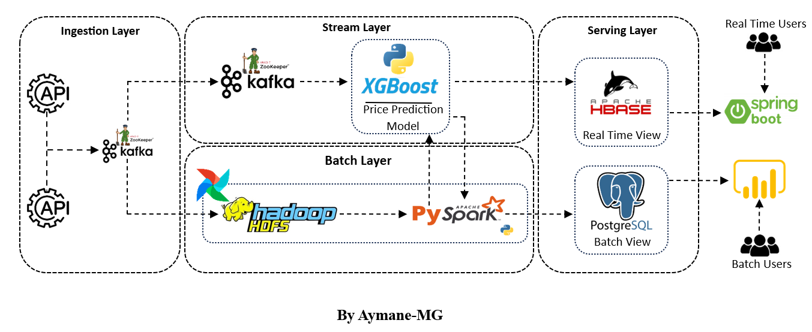
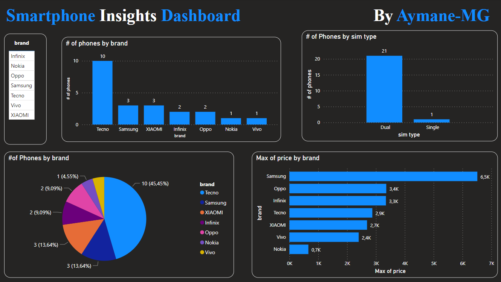
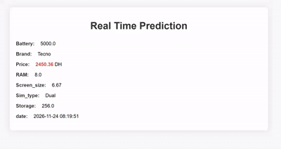
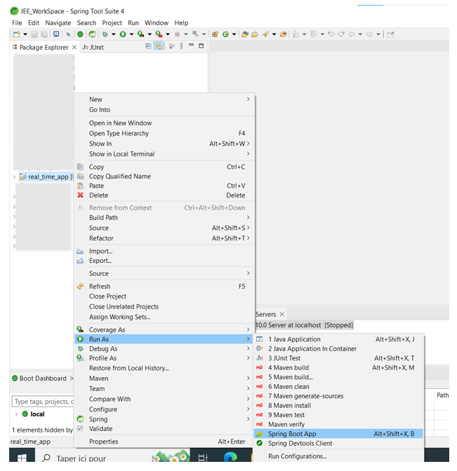
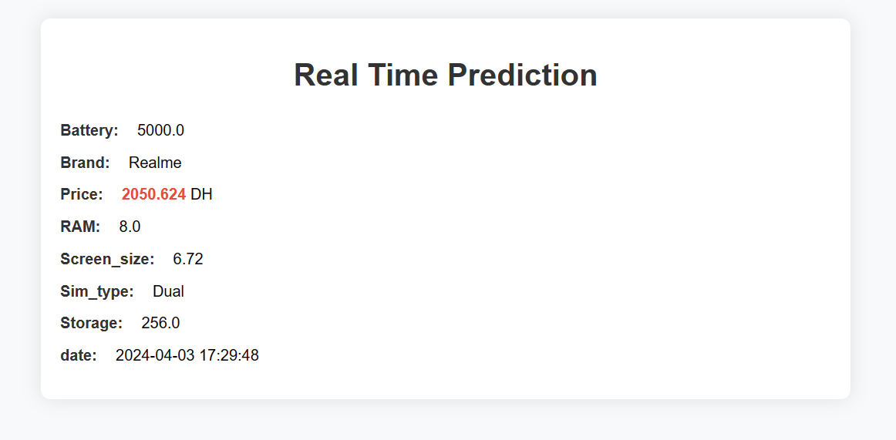
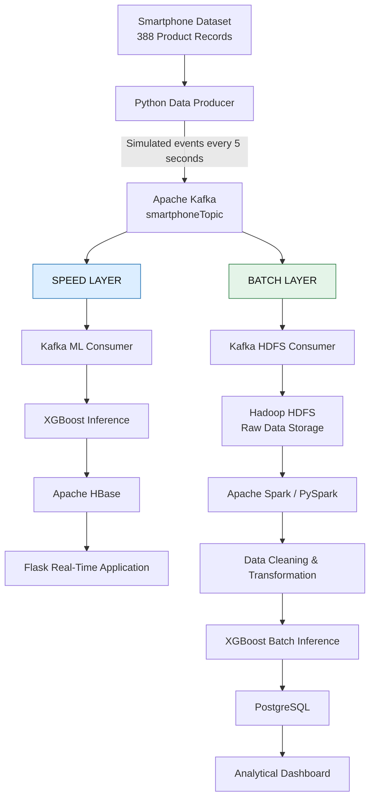

# Real-Time Big Data & Smartphone Price Prediction Platform

### Distributed Streaming, Batch Processing & Machine Learning Using Lambda Architecture

<p align="center">
  
</p>

<p align="center">
  
  
  
  
  
  
  
  
</p>

---

## Overview

An end-to-end Big Data and Machine Learning platform implementing **Lambda Architecture** to demonstrate distributed data ingestion, real-time stream processing, batch analytics, and machine learning inference.

The platform simulates a continuous stream of smartphone product records, processes incoming events through Apache Kafka, and distributes them across two independent processing pipelines:

- **Speed Layer:** Performs low-latency machine learning inference and stores predictions in Apache HBase for real-time retrieval.
- **Batch Layer:** Persists incoming records in Hadoop HDFS, processes accumulated data using Apache Spark, performs batch inference using a pretrained XGBoost model, and stores analytical results in PostgreSQL.

The platform provides a real-time prediction interface and an analytical dashboard for exploring smartphone prices, manufacturers, hardware specifications, and predicted market segments.

The primary engineering focus is the integration of distributed technologies into a unified data processing ecosystem.

## Project Demonstration

### 1. Analytical Dashboard

The analytical dashboard provides an overview of accumulated smartphone predictions and their distribution across different product attributes.

<p align="center">
  
</p>

<p align="center">
  
</p>

The dashboard includes:

- Total processed smartphone records.
- Average and maximum predicted prices.
- Smartphone distribution across brands.
- Average predicted price by manufacturer.
- Price comparisons by RAM and storage capacity.
- SIM configuration distribution.
- Top 20 highest predicted smartphone prices.

### 2. Real-Time Machine Learning Prediction

The speed layer processes incoming smartphone events and generates predictions immediately using the pretrained XGBoost model.

<p align="center">
  
</p>

Each incoming record is processed independently, and the latest prediction is stored in HBase before being displayed through the Flask application.

### 3. Application Execution

The following screenshots demonstrate the application execution environment and prediction interfaces.

<p align="center">
  
</p>

<p align="center">
  
</p>

---

## System Architecture

The platform follows Lambda Architecture, separating low-latency stream processing from comprehensive batch processing.



### Data Flow

**1. Data Ingestion – Python Producer**

A Python producer reads smartphone records from the source dataset and simulates a continuous incoming data stream by publishing a randomly selected record to Kafka every five seconds.

**2. Event Streaming – Apache Kafka**

Kafka acts as the central messaging platform.

Every incoming smartphone record is published to the `smartphoneTopic` topic. Two independent consumer groups subscribe to the same topic, allowing the speed and batch layers to process every event independently.

**3. Speed Layer – Real-Time Processing**

The streaming consumer:

- Retrieves incoming Kafka messages.
- Deserializes smartphone records.
- Prepares the required machine learning features.
- Loads the pretrained XGBoost model.
- Predicts the smartphone selling price.
- Stores the prediction in Apache HBase.

The Flask application retrieves the latest prediction from HBase and displays it through a real-time web interface.

**4. Batch Layer – Distributed Processing**

A separate Kafka consumer captures incoming records and persists them as individual CSV files in Hadoop HDFS.

Every 60 seconds, the batch-processing job:

- Reads accumulated records from HDFS using PySpark.
- Converts numerical attributes into appropriate data types.
- Filters records with missing required features.
- Encodes categorical attributes.
- Prepares model-compatible feature vectors.
- Applies the pretrained XGBoost model to generate predictions.
- Writes the analytical results into PostgreSQL.

**5. Analytical Serving**

PostgreSQL stores the batch prediction results in a structured `Phone` table, which serves as the data source for analytical visualizations.

---

## Technology Stack

| Category | Technology | Purpose |
|---|---|---|
| Programming Language | Python 3.10 | Pipeline development |
| Message Streaming | Apache Kafka | Distributed event ingestion |
| Kafka Coordination | ZooKeeper | Kafka broker coordination |
| Stream Processing | Python Kafka Consumers | Real-time event processing |
| Distributed Storage | Hadoop HDFS 3.2.1 | Raw data storage |
| Batch Processing | Apache Spark 3.3.4 | Batch transformations |
| Processing API | PySpark | Spark-based data processing |
| NoSQL Database | Apache HBase 1.3 | Low-latency prediction storage |
| Machine Learning | XGBoost 2.x | Smartphone price regression |
| Data Manipulation | Pandas, NumPy | Feature preparation |
| Relational Database | PostgreSQL 13 | Batch prediction storage |
| Database Connectivity | SQLAlchemy, Psycopg2 | Database integration |
| Web Framework | Flask 3.0.3 | Real-time prediction interface |
| Visualization | Grafana | Analytical dashboards |
| Containerization | Docker | Infrastructure packaging |
| Orchestration | Docker Compose | Multi-container deployment |
| Development Environment | WSL2 / Ubuntu | Local development |

---

## Dataset & Machine Learning Model

### Dataset

The project uses a smartphone dataset containing **388 product records** with attributes including:

- Brand and model.
- Screen size.
- RAM and internal storage.
- SIM configuration.
- Battery capacity.
- Camera specifications.
- Ratings and reviews.
- Seller information.

The producer randomly selects records from this dataset to simulate incoming smartphone events.

### XGBoost Regression Model

A pretrained XGBoost regression model predicts smartphone prices using six input features:

| Feature | Description |
|---|---|
| Brand | Smartphone manufacturer |
| Screen Size | Display dimensions |
| RAM | Available memory |
| Storage | Internal storage |
| SIM Type | SIM configuration |
| Battery | Battery capacity |

**Prediction output:** Estimated smartphone selling price in Moroccan Dirhams (DH).

The same pretrained model is used by both processing layers to maintain consistency in prediction logic.

The model performs inference only; incoming records do not automatically retrain or update the model.

---

## Data Engineering Implementation

### Event-Driven Ingestion
- Continuous event generation using Python.
- Kafka-based message publishing.
- Independent consumer groups.
- Decoupled ingestion and downstream processing.

### Distributed Storage
- Hadoop HDFS for raw incoming records.
- Apache HBase for low-latency prediction retrieval.
- PostgreSQL for structured analytical results.

### Data Transformation
- Numerical type conversion.
- Missing-value filtering.
- Categorical feature encoding.
- Machine learning feature preparation.
- Batch processing of accumulated records.

### Pipeline Orchestration
- Docker Compose-based infrastructure.
- Independent application services.
- Automated batch execution at configurable intervals.
- Environment-based configuration.
- Persistent Docker volumes.

---

## Repository Structure

```text
big-data-lambda-smartphone-prices/
│
├── images/
│   ├── architecture.png
│   ├── dashboard_phone.png
│   ├── dashboard_phone-2.png
│   ├── real-time.gif
│   ├── run_web_app.png
│   └── spring_boot_web_app.png
│
├── Main/
│   └── Lambda/
│       ├── Stream_layer/
│       │   ├── ML_consumer.py
│       │   ├── stream_pipeline.py
│       │   └── insert_data_hbase.py
│       │
│       ├── Batch_layer/
│       │   ├── HDFS_consumer.py
│       │   ├── batch_pipeline.py
│       │   ├── batch_layer.py
│       │   ├── spark_tranformation.py
│       │   ├── put_data_hdfs.py
│       │   └── save_data_postgresql.py
│       │
│       ├── real_time_web_app(Flask)/
│       │   ├── app.py
│       │   └── get_Data_from_hbase.py
│       │
│       ├── producer.py
│       ├── transform.py
│       ├── config.py
│       └── batch_loop.py
│
├── Dockerfile
├── docker-compose.yml
├── hadoop.env
├── requirements.txt
├── RUN.md
├── .gitignore
└── README.md
```

*The smartphone dataset, pretrained model, and Flask template are runtime assets and should also be included in the repository or documented separately.*

---

## Deployment & Execution

### Prerequisites

- Docker Desktop.
- Docker Compose.
- WSL2 with Ubuntu (recommended for Windows users).
- Git.

### 1. Clone the Repository

```bash
git clone https://github.com/YOUR_USERNAME/big-data-lambda-smartphone-prices.git

cd big-data-lambda-smartphone-prices
```

### 2. Prepare Runtime Assets

Ensure the smartphone CSV dataset, pretrained XGBoost model, and Flask HTML template are available in their expected application paths.

### 3. Build and Start the Infrastructure

```bash
docker compose up -d --build
```

### 4. Verify Running Containers

```bash
docker compose ps
```

### 5. Monitor the Streaming Pipeline

```bash
docker compose logs -f stream
```

### 6. Monitor HDFS Ingestion

```bash
docker compose logs -f hdfs-ingest
```

### 7. Monitor Batch Processing

```bash
docker compose logs -f batch-loop
```

### 8. Stop the Infrastructure

```bash
docker compose down
```

To remove persistent Docker volumes as well:

```bash
docker compose down -v
```

---

## Service Endpoints

| Service | Local Endpoint | Purpose |
|---|---|---|
| Flask Application | http://localhost:5000 | Real-time predictions |
| HDFS NameNode UI | http://localhost:9870 | HDFS monitoring |
| HBase Master UI | http://localhost:16010 | HBase monitoring |
| Kafka | localhost:9092 | Event streaming |
| PostgreSQL | localhost:5433 | Batch prediction database |
| Grafana | localhost:3000 | Analytical dashboard, when separately configured |

---

## Engineering Considerations & Future Improvements

| Area | Potential Improvement |
|---|---|
| Data Source | Replace simulated events with a live external source |
| Data Quality | Implement comprehensive validation and quality checks |
| Kafka | Add schema management and optimized partitioning |
| Stream Processing | Introduce Spark Structured Streaming |
| Batch Orchestration | Integrate Apache Airflow |
| Machine Learning | Add model versioning, monitoring, and automated retraining |
| Scalability | Deploy Spark on a distributed cluster |
| Database | Introduce incremental and upsert-based writes |
| Monitoring | Integrate Grafana and Prometheus |
| Reliability | Implement retries, dead-letter queues, and idempotency |
| Data Governance | Add schema enforcement and lineage tracking |

---

## Key Learning Outcomes

This project demonstrates practical implementation of:

- Lambda Architecture and distributed data processing.
- Event-driven ingestion using Apache Kafka.
- Independent real-time and batch processing pipelines.
- Distributed storage using Hadoop HDFS.
- NoSQL integration using Apache HBase.
- Batch transformations using Apache Spark and PySpark.
- Machine learning inference within data pipelines.
- Relational analytical storage using PostgreSQL.
- Python-based pipeline development.
- Containerized infrastructure using Docker Compose.

---

## Project Objective

The objective of this project is to demonstrate how modern Big Data technologies can be integrated into an end-to-end data engineering platform.

By combining distributed messaging, scalable storage, parallel processing, machine learning inference, and analytical serving, the platform illustrates the engineering principles behind real-time data systems and large-scale analytical pipelines.

<p align="center">
  <b>Built around data. Powered by distributed processing. Enhanced with machine learning.</b>
</p>
